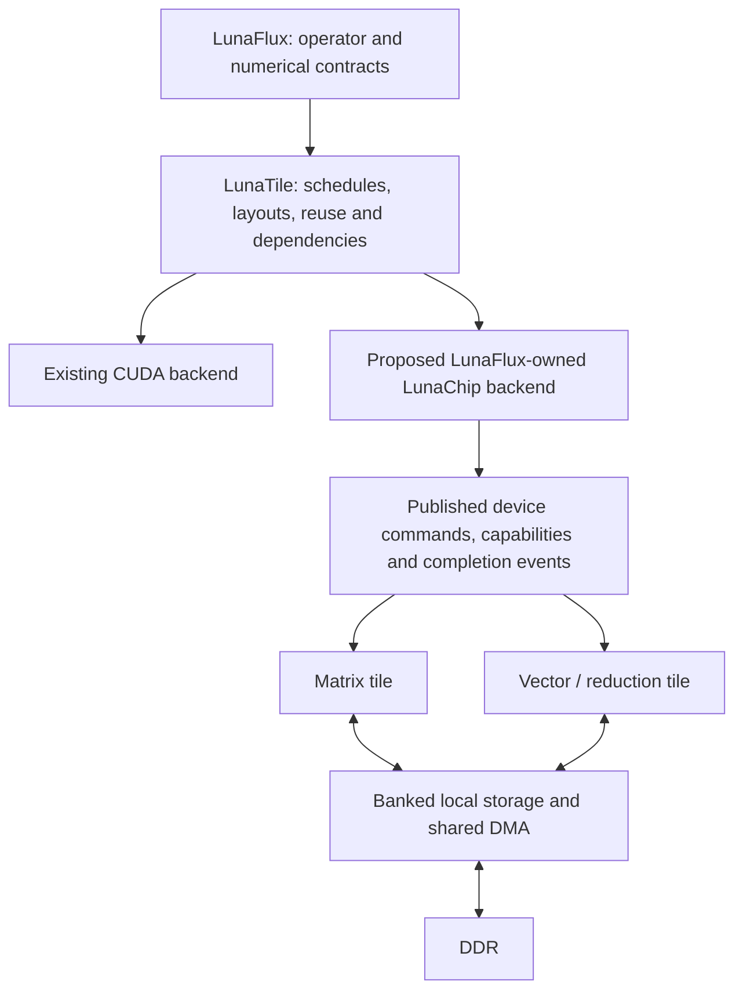

# LunaTile hardware backend and heterogeneous tiles

Recorded: 2026-10-28 (Asia/Shanghai).

Status: architecture direction recorded from discussion and source inspection.
This is a proposal for future work, not an implemented backend, a frozen device
ABI, a new hardware qualification, or closure of an existing phase gate.

## Direction

Use LunaFlux's own LunaTile compiler to drive a LunaChip reference accelerator
with a common tile interface and potentially heterogeneous execution units.
Preserve numerical semantics, storage ownership and dependency ordering across
the software/hardware boundary. Start with a small matrix/vector combination
and measure data movement before increasing the number of compute units.

The language discussed here is LunaFlux's LunaTile, not the external TileLang
project. Existing LunaTile middle ends provide a substantial starting point;
the missing integration is a LunaChip device backend and its hardware contract.

## Existing software foundation

The following source was inspected in the sibling LunaFlux checkout. These are
source references, not a sealed cross-repository validation snapshot.

| Component | Existing responsibility | Relevance to the proposed backend |
| --- | --- | --- |
| [LunaTile IR](../../lunaflux/kernels/luna_tile_ir/README.mbt.md) | Typed tensor views, copies, MMA, reductions, elementwise operations, barriers and pipeline stages | Define an explicitly supported instruction subset and its legality checks |
| [Projection compiler](../../lunaflux/kernels/luna_projection_tile_compiler/README.mbt.md) | Semantic graphs, ordered folds, reuse, schedules and physical refinement | Reuse workload semantics and scheduling decisions before CUDA realization |
| [Physical tile IR](../../lunaflux/compiler/physical_tile_ir/README.mbt.md) | Operand layouts, fragment dataflow, independent accumulators, storage lifetimes and producer/consumer ownership | Map these plans to banked SRAM, registers, queues and completion events |
| [Precision IR](../../lunaflux/compiler/precision_ir/README.mbt.md) | Precision, rounding boundaries and explicit reduction laws | Reject unsupported numerical laws instead of silently changing arithmetic |
| [Attention physical IR](../../lunaflux/compiler/attention_physical_ir/README.mbt.md) | Online-softmax state, QK/PV folds and publication effects | Preserve attention's state and numerical laws across matrix/vector execution |
| [Elementwise physical IR](../../lunaflux/compiler/elementwise_physical_ir/README.mbt.md) | Normalization, rotary, KV writes and selection | Give non-matrix operations explicit execution and effect semantics |
| [Recurrent physical IR](../../lunaflux/compiler/recurrent_physical_ir/README.mbt.md) | Ordered preparation, solve and output/state-commit effects for an explicit recurrent policy | Inform later workload coverage without claiming current hardware support |
| [Resource policy](../../lunaflux/compiler/resource_policy/README.mbt.md) | Resource eligibility and identity-bound measured/unmeasured policy selection | Select hardware mappings from actual capability and measurement records |

The older generic `luna_tile_ir` path is not the sole production compilation
route. Its CUDA planning includes warp/block concepts, while the shared
physical dialect deliberately avoids vendor instruction and warp-width terms.
The new backend should branch before CUDA-specific realization; translating
generated CUDA or equating a GPU block with an FPGA tile is not the proposal.

In particular, [ProducerConsumerPipeline](../../lunaflux/compiler/physical_tile_ir/producer_consumer.mbt)
requires publication after all producers complete and slot reuse after all
consumers retire. Hardware double buffering and DMA events must implement those
rules. An immutable compiler descriptor alone does not establish that hardware
obeys them.

## Software tiles and hardware tiles

A software tile is a bounded region of a computation, such as an M-by-N output
block with a K reduction extent. A hardware tile is an execution module with
command handling, compute resources, local storage and communication ports.

The mapping is not one-to-one. One hardware tile may execute many software
tiles over time; a large software tile may be decomposed across hardware tiles.
Array dimensions, local SRAM capacity and physical tile count are independent
design parameters, constrained by the admitted numerical and effect laws.

LunaChip owns hardware construction, RTL semantics, simulation and the
published device contract. LunaFlux owns its compiler/backend adapter and
runtime scheduling. Integration consumes versioned artifacts and contracts;
it must not introduce a LunaFlux import into LunaChip or expose LunaChip
elaboration/simulator types through LunaFlux public contracts. Existing
[product boundaries](PRODUCT_CONTRACT.md) remain authoritative.

## Initial hardware proposal

Begin with one matrix tile, one vector/reduction tile and shared DMA. Use one
compute clock domain initially, retaining explicit crossings to board transport
and memory clocks. Choose array dimensions and storage capacities through
simulation, synthesis and measurement rather than assuming a 4-by-4 or 8-by-8
physical tile array will fit or scale.

| Module | Initial responsibilities | Existing hardware to evaluate for reuse |
| --- | --- | --- |
| Matrix tile | GEMV/GEMM, operand reuse and persistent accumulators | FluxTile INT8 array and the Qwen sixteen-row BF16-weight/FP32 engine |
| Vector/reduction tile | Add, multiply, sum, maximum, normalization and required exponential/reciprocal-root operations | Qwen vector and nonlinear datapaths |
| Storage/transfer module | Address generation, DMA, double buffering, bank arbitration and completion events | Existing memory bridges and storage components |

These are candidate building blocks, not already interchangeable tile modules.
The Qwen engine's components need explicit interfaces and decoupling. Current
FluxTile `MatMul` starts from zero; accumulation across K tiles requires a
specified mechanism. The Qwen BF16-weight/FP32-activation numerical path does
not establish support for every BF16 MMA contract. Existing separate product
and sum rounding cannot silently become FMA or a reassociated reduction.

Keep the tile shell uniform: versioned commands, capability discovery,
completion identity, dependency events, faults, reset and ownership rules.
Execution units may differ in supported operations, precision, width and local
storage. The compiler must check those capabilities before constructing an
executable artifact. Unsupported combinations return explicit errors.

Do not require FFT, SNN or polynomial accelerators in the first design. Add
special-function tiles only when supported target workloads and measurements
justify their area, storage and communication costs.

## Data movement and scaling

An existing PRX100 experiment increased matrix rows from sixteen to thirty-two
but improved complete-layer resident end-to-end latency by only 2.24% under
that experiment's unchanged transport and scalar/nonlinear workload. It is
evidence against assuming proportional system gains from more arithmetic, not
a performance prediction for the proposed design. See the
[measured compute experiment](PRX100_QWEN_LAYER_COMPUTE.md).

The current [PBlaze3 memory bridge](../targets/pblaze3_axi/README.mbt.md) uses
one outstanding, single-beat 128-bit AXI transaction. Multiple compute tiles
would share the existing DDR subsystem. Replication cannot by itself increase
memory bandwidth. The current [PBlaze3 exporter](../cmd/pblaze3/main.mbt) selects
the sixteen-row feedback/delivery Qwen core; it does not instantiate the
proposed heterogeneous cluster.

Evaluate operand reuse, local intermediate retention, transfer/compute overlap,
bank conflicts and bounded transaction concurrency alongside compute width.
Avoid sending matrix/vector intermediates through DDR when a legal local
handoff can preserve the same observable effects and numerical boundaries.

Use a bounded arbitrated interconnect for the initial small cluster. Select a
ring or mesh only after traffic and contention measurements justify it. Reusing
a verified tile does not eliminate system-level deadlock, starvation, reset,
CDC, routing or timing checks. A fault or reset must invalidate stale ownership
and completion events without falsely implying rollback of committed writes.

## Proposed implementation sequence and acceptance

1. Define the capability, numerical, storage, command and event contract for a
   deliberately small supported subset. Keep existing device ABIs and qualified
   images unchanged. Specify accumulator initialization/continuation, tails,
   bounds, alias rules, completion visibility and partial-fault behavior.
2. Add a LunaFlux-owned offline lowering for a supported
   copy -> matrix -> vector/reduction -> store program. Preserve the original
   numerical and dependency contract; do not introduce request-path JIT.
3. Construct the matching LunaChip hardware in MoonBit and compare it with an
   independent functional oracle and deterministic LunaWave execution. Check
   stage reuse, backpressure, tails, invalid commands, faults and resets.
4. Pass the applicable native, pinned Verilator differential, Yosys synthesis
   and formal gates before FPGA implementation. Record source/tool identities,
   assumptions, bounds and negative controls. Physical acceptance requires the
   existing clock/timing/DRC/CDC and actual board gates.
5. Compare one-tile, replicated and matrix/vector configurations under declared
   FPGA resource budgets. Measure complete-task latency, DDR bytes, compute
   utilization, memory/dependency stalls and local bank conflicts. Preserve
   setup, transfer and host overhead boundaries in every comparison.
6. Use the results to choose replication, memory-path improvements and later
   special-function units. Report energy only with an identified instrument
   and measurement conditions; FPGA measurements do not establish ASIC energy.

The first integration milestone is the same supported LunaTile program
executing through the new backend and matching its numerical/effect contract
in hardware simulation. A software functional-device test alone is not this
milestone. The [existing complete-layer host functional campaign](../artifacts/pblaze3-full-layer-host-functional-20261028-a3/README.md)
remains separate evidence and does not validate a new tile backend.

This sequence is a proposed follow-up to the accelerator-utility direction.
It does not waive Phase 6/7 gates or claim Phase 8 has started or passed.

## External research and limits

The supplied MOSAIC discussion refers to the work now titled
[TESSERA, arXiv:2606.05362v3](https://arxiv.org/abs/2606.05362v3), revised
2026-09-21. It explores heterogeneous Big, Little and special-function tiles.
Its reported 46.91% mean energy saving is a design-space-search result for a
roughly 200 mm2, iso-area comparison over twenty workloads using calibrated
7 nm cost models. It is not a measured benefit of this Kintex-7 implementation.

[Arteris' 2024-10-15 announcement](https://www.arteris.com/press-releases/arteris-network-on-chip-tiling-innovation-accelerates-semiconductor-designs-for-ai-applications/)
reports average 20% power reduction and up to 50% integration/design-time
reduction in its stated NoC tiling context. These are vendor-reported results,
not universal project targets. The latter includes XPU subsystem design and
SoC connectivity integration; it does not establish that the entire chip
development and qualification cycle halves.

Homogeneous/heterogeneous composition, clock-domain partitioning, dynamic
frequency scaling, clock gating and power gating are separate choices.
Initially use explicit enables and, where separately validated, dedicated
clock-gating resources. AMD documents BUFGCE/BUFHCE-family mechanisms for
reducing dynamic power in 7-series devices in
[UG949](https://docs.amd.com/r/en-US/ug949-vivado-design-methodology/Gating-the-Clock-Buffer).
This proposal makes no per-tile ASIC power-island or FPGA energy-saving claim.

## Open decisions

- First admitted dtype, MMA shape and accumulation/numerical laws.
- Matrix/vector split and the cost of decoupling existing Qwen components.
- Local storage sizes, bank/port counts and intermediate handoff semantics.
- Command encoding, event capacity, fairness and reset/fault recovery rules.
- Memory concurrency and burst strategy after measuring the board path.
- Workload mix and resource budgets used to select tile composition.

Resolve these through the proposed contract and measured implementation work;
recording this direction does not settle them or authorize a new performance
claim.
