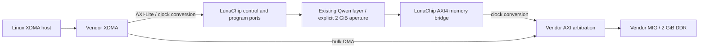

# PBlaze3 2 GiB target preparation

The [October 28 software follow-up](PBLAZE3_SOFTWARE_PREPARATION.md) adds
pre-arrival host hardening and offline delivery checks. Its evidence is
additive; the October 26 hardware images and archived results remain intact.

Date: 2026-10-26. Status: the 2 GiB port is implemented and both DDR-smoke and
accelerator bitstreams pass physical-build acceptance with independent reset
and scoped CDC review. Vivado 2026.1 is installed beside 2025.2 with a free
BASIC certificate valid through 2027-10-26; actual XC7K325T synthesis and
implementation license checkout succeed. The full default native regression
passes 1,349/1,349 tests on its frozen source baseline. The final physical-recipe
delta passes 16 targeted tests, global info/fmt/strict checks, and fresh actual
Vivado preparation of both profiles. Digital and canonical-reset EDA source
inventories remain unchanged after that delta.
Physical board testing is pending board arrival. This document distinguishes
implemented software, generated hardware, independent tool results, and actual
board evidence; none substitutes for another.

## Scope

Add a host-attached PBlaze3 target for the existing Qwen layer reference design.
The initial profile uses eight 256 MiB DDR3 components, 2 GiB total, as explicitly
selected by the user. The actual DRAM markings and electrical configuration
remain to be checked on arrival. Preserve the PRX100 default profile and its
existing artifacts. LunaWire, canonical IR, LunaWave, floating-point arithmetic,
and existing reference fixtures remain shared. No LunaFlux dependency is added.

The first deliverable executes the existing layer workload through PCIe and
checks its outputs. Complete-model serving, tokenization, model scheduling and
KV-cache policy remain outside this board-adaptation scope and the LunaChip
product boundary.

## Supplied material and unresolved facts

The source archive is `~/Downloads/wang_memblaze资料.7z`, containing
`1_测试工程/xdma_ddr.7z`, pin definitions, and a Windows test executable.
The nested project README identifies Memblaze PBlaze3/XC7K325TFFG900-2.
The active project and implementation reports use Vivado 2024.2; an older
README mentions 2019.1. The XPR/BD and active MIG configuration are authoritative
for reconstructing the supplied design, not the older prose.

| Item | Supplied active project | Initial LunaChip profile |
|---|---|---|
| FPGA | XC7K325TFFG900-2 | same, provisional until board ID readback |
| PCIe | Gen2 x8, XDMA 4.1 on Vivado 2024.2 | Gen2 x8, XDMA 4.2 verified in both Vivado 2025.2 and 2026.1 catalogs; negotiated link checked on arrival |
| DDR data width | 64 bits, ECC disabled | same, subject to pin/part confirmation |
| DRAM geometry | MT41K512M8, 16 row bits, 4 GiB | eight 256 MiB x8 parts, 2 GiB provisional |
| MIG AXI | 128-bit data, 32-bit byte addresses, 200 MHz | 128-bit data, 31-bit mapped address, 200 MHz; digital bridge uses checked 32-bit addresses |
| Compute clock | no LunaChip compute core | conservative 33.333 MHz target |
| AXI-Lite window | 1 MiB BAR; only 64 KiB mapped to GPIO at 0x40000000 | full 1 MiB mapped at the same base |

The supplier notes intermittent data errors. The retained timing report has
positive constrained setup/hold slack but also 72 no-clock pins, 56
unconstrained internal endpoints, and a GT clock-waveform critical warning.
The cause of the data errors is unknown. The supplied source is a starting
point, not qualified memory or PCIe evidence. The active MIG pin file also
retains ninth-byte entries although ECC is disabled; preserve original source
provenance and explicitly select only active pins in the new profile.

## Digital architecture

The control, core and new AXI bridge share one compute clock. Vendor clock
converters explicitly cross to XDMA and MIG clocks. Reset and memory readiness
must be coordinated across outstanding transactions. The initial bridge uses
bounded single-beat 128-bit AXI transactions and supports the existing scalar,
wide, packed sixteen-row and paired-delivery request semantics. This prioritizes
an executable reference target; sustained burst throughput is a later measured
optimization, not an assumed property of the 64-bit physical DDR bus.

The two-master physical AXI interconnect must preserve both the XDMA transaction
ID and the originating master. The accelerator profile therefore selects a
5-bit MIG AXI ID width for the 4-bit XDMA thread ID plus master index; the
single-master DDR smoke and vendor baseline retain 4 bits. The actual Vivado
propagated interface properties are retained with build evidence.

The initial compute profile is `feedback_layer_machine(delivery=true,
memory=GiB2)`: sixteen matrix rows, eight FP32 transport words per reply and
the current ordered FP32 feedback arithmetic. It shares the existing descriptor
ISA and BF16/FP32 numerical behavior. The latest PRX100 profile additionally
interleaves four nonlinear contexts; this bring-up profile uses the earlier
nonlinear schedule. Porting that optional schedule is a subsequent measured
profile change. More FPGA resources and a wider physical DDR bus alone do not
establish a speedup: this first AXI bridge has one outstanding 128-bit beat and
the accepted 33.333 MHz core clock has passed routed timing but has no measured
board throughput yet.

`MemoryAperture::MiB256` remains the default for all existing generators.
The opt-in `GiB2` profile carries complete 32-bit byte addresses and checks
extent arithmetic before narrowing. Native tests compare default and explicit
legacy canonical IR and exercise the last legal word, crossing/wrapping ranges,
packed sixteen-row strides and the former 256 MiB boundary.

## Control ABI 1.1

Host BAR offsets below are relative to a 1 MiB AXI-Lite aperture. The vendor
AXI address is `0x40000000 + offset`; the digital wrapper removes that base.
All register accesses are aligned 32-bit little-endian words. Program and
scratch writes are rejected while the compute engine owns them. DDR transfers
use XDMA memory-mapped DMA separately and must not overwrite live computation
data; host software owns this exclusion in the initial contract.

| Offset | Meaning |
|---|---|
| 0x00 | target ID 0x50423330 (`PB30`) |
| 0x04 | ABI version 0x00010001 |
| 0x08 | status bits: 0 memory healthy, 1 busy, 2 done, 3 fault |
| 0x0c | error code |
| 0x10 | write 1 to START |
| 0x14 | program instruction count, 1..2048 |
| 0x18..0x34 | PC, state, opcode, cycle low/high, instructions, products, DDR beats |
| 0x38 | accepted START sequence, unsigned 32-bit, wraps modulo 2^32 |
| 0x3c | optional resident program DDR base; 64-byte aligned; zero uses local program RAM |
| 0x40 | optional DDR-to-program-RAM staging cycles, reset by accepted START |
| 0x44 | FP32 argmax vector length in words (0..151936). Writing it clears the current result. |
| 0x48 | Writing an aligned DDR vector base arms a fresh reduction. The entire nonempty vector must fit the 2 GiB aperture. |
| 0x4c | Token index of the first maximum, or 0xffffffff while incomplete or invalid. |
| 0x80 | memory bytes low: 0x80000000 |
| 0x84 | memory bytes high: 0 |
| 0x88 | usable byte-address bits: 31 |
| 0x8c | profile flags: bit 0 provisional board configuration |
| 0x90 | optional resident-loader capability; 1 enables 0x3c/0x40 (older images reject these offsets) |
| 0x94 | A value of 1 advertises streaming argmax and the contiguous completion snapshot. |
| 0xa0..0xd4 | Fourteen consecutive read-only words: sequence, status, error, count, PC, state, opcode, cycles low/high, instructions, products, DDR beats, loader cycles and sequence. |
| 0x20000..0x3ffff | program RAM, 2048 instructions x 16 words |
| 0x40000..0x5ffff | scratch RAM, 32768 words |

DDR addresses are offsets in `[0, 0x80000000)`. End calculations must be wider
than the address and reject wrap, crossing the aperture, malformed alignment
and invalid packed-row strides before external memory commands. No modulo
address truncation is permitted. A runtime fault is sticky until coordinated
device reset; a timeout must report failure rather than silently retry START.

The launch sequence advances only when START is accepted and clears on the
coordinated device reset. A rejected write, held response or stale DONE never
advances it. The host reads the previous sequence, verifies the instruction
count write, then requires exactly the next sequence and expected count before
accepting completion. It brackets each status snapshot with sequence reads so
a new launch cannot be combined with an old DONE sample. Observing BUSY is not
required: a short job may finish before the first poll. This protects completion
freshness even when a posted PCIe START write is lost or rejected.

## Implementation work and acceptance order

1. Check in provenance, provisional board profile and repeatable build recipe.
   Recreate vendor IP from pinned configuration; keep build caches outside
   evidence and do not archive copied vendor caches.
2. Add explicit 2 GiB Qwen memory aperture while preserving default PRX100
   semantics. Exercise high-address loads/stores, upper-bound and overflow
   rejection, and packed matrix accesses.
3. Implement a same-clock LunaWire AXI4 bridge and new controller/composition.
   Check independent AXI channels, stalled payload stability, masks, response
   faults, 4 KiB boundaries, readiness loss and coordinated-reset behavior.
4. Add host manifest/transport validation, deterministic DDR diagnostics,
   upload/readback and bounded start/poll/error reporting. Offline mock tests
   must never touch a real device.
5. Run native info/fmt/check/tests, pinned Verilator differential checks,
   pinned Yosys synthesis and named formal tasks with negative controls.
6. Rebuild the vendor composition with Vivado when available; record exact
   tool/IP versions, timing, CDC, DRC, clock and source identities. Generated
   Tcl alone does not count as synthesis or routing evidence.
7. On arrival, confirm FPGA/DRAM/power/pins, establish JTAG recovery, load a
   volatile smoke image, and verify calibration plus complete DDR addressing.
   Test aliases, patterns, readback, repeated resets, cold boots and soak.
8. Run the existing single-layer reference workload first in low memory and
   then at high DDR offsets. Compare actual words and counters before changing
   lane count, clock frequency or AXI throughput.

## Evidence ledger

The implementation is split into focused packages:

| Component | Location | Responsibility |
|---|---|---|
| Memory aperture | `designs/qwen_layer` | Explicit 2 GiB arithmetic and unchanged 256 MiB default |
| AXI memory bridge | `targets/pblaze3_axi` | Independent AXI channels, checked extents, masks, held responses and poison/drain |
| Control and composition | `targets/pblaze3_layer`, `targets/pblaze3_system` | ABI 1.1, launch freshness, program/scratch RAM access and exact RTL wiring |
| Digital export | `cmd/pblaze3` | Canonical IR, ordinary/implementation RTL, name maps and source hashes |
| Physical generation | `targets/pblaze3_board`, `cmd/pblaze3_board` | MIG geometry, original pin provenance, CDC/reset, reproducible Vivado inputs |
| Linux host | `targets/pblaze3_host`, `cmd/pblaze3_host`, `scripts/pblaze3-*.mbtx` | Upstream XDMA transport, diagnostics, bounded execution and CPU comparisons |
| Independent verification | `validation/pblaze3_axi`, `validation/pblaze3_layer` | Adapter and integrated-core LunaWave oracles, RTL replay and formal artifacts |

The [arrival runbook](PBLAZE3_BRINGUP.md) contains executable preparation and
board commands. [Board inputs](../boards/pblaze3/README.md) document exact source
provenance and physical assumptions; the [host guide](../targets/pblaze3_host/README.mbt.md)
documents transport behavior and failure handling.

Final gate results and evidence locations are recorded below when each run
finishes. Board calibration, full-memory reliability, PCIe negotiation and
Qwen board execution remain pending board arrival. Existing sealed PRX100
evidence is immutable.

- **Legacy identity:** the default PRX100 interleaved export was regenerated and
  all 16 corresponding files matched the sealed
  `prx100-layer-add2-20261023/inputs` byte for byte, including canonical IR,
  ordinary/implementation RTL, wrapper, top, constraints and SHA256 inventory.
  The [receipt](../artifacts/pblaze3-preparation-20261026/legacy-compatibility/receipt.json)
  records the comparisons and current Qwen source identities.
- **Host preparation:** [retained mock evidence and fixtures](../artifacts/pblaze3-host-preparation-20261026/README.md)
  cover 14 transport/control and five campaign scenarios, including aliasing,
  short transfers, timeouts, wrong ABI, altered inputs and wrong results. The
  archived full Qwen-layer fixture passes offline input/reference validation.
  These mock tools never open real hardware device nodes and do not simulate
  accelerator arithmetic.
  The [smoke-status follow-up](../artifacts/pblaze3-host-smoke-status-20261026/README.md)
  extends this to **17 transport/control plus five campaign scenarios** and
  11 strict native host tests. The DDR smoke image reports calibration, link
  and reset state; its memory test refuses DMA while any required status is low.
  The final ABI 1.1 [launch-sequence follow-up](../artifacts/pblaze3-host-launch-sequence-20261026/README.md)
  passes **12 native tests, 22 mock host scenarios and five fixture campaigns**.
  It verifies dropped START with stale DONE, count-write rejection, immediate
  completion, sequence wrap and unexpected sequence changes, retaining each
  negative case's specific error and nonzero exit status.
  The same frozen source then passed [Linux x86_64 preparation](../artifacts/pblaze3-linux-host-preparation-20261026-a2/README.md)
  on Ubuntu 22.04 with the identical MoonBit release: **12 native tests,
  22 host scenarios, five campaigns**, both original fixture plans and a
  release CLI self-test. Its executable remains in the VM's active work tree;
  the archive records its path, hash, GCC 11.4 and glibc 2.35 dependencies.
  The first transfer attempt rejected macOS metadata files before compilation;
  that failure remains retained. The corrected source-only transfer passed
  before/after source hash checks. No driver or hardware was involved.
- **Official XDMA compatibility:** building the [pinned upstream tools](../artifacts/pblaze3-xdma-userspace-preparation-20261026/README.md)
  exposed a mismatch between the real `reg_rw` output (`32-bit`) and the
  earlier mock/parser (`32-bits`). The parser now accepts the official form
  and the mock emits it. The [focused correction](../artifacts/pblaze3-host-reg-output-20261026/README.md)
  passes seven format/boundary/error regressions. The final
  [Linux host follow-up](../artifacts/pblaze3-linux-host-preparation-20261026-a3/linux/PASS)
  repeats all 12 native tests, 22 host scenarios, five campaigns and seven
  parser checks. It also executes the actual official tools against ordinary
  files: register read/write and complete ABI status, a 16-byte DMA roundtrip
  at `0x7ffffff0`, rejection of a short EOF read, and the production host
  upload/readback path all pass. A sparse 2 GiB test file consumes only 4 KiB
  of disk blocks. The [test runner receipt](../artifacts/pblaze3-xdma-regular-file-source-20261026/receipt.json)
  links the exact tool, source and evidence identities. This supersedes the
  earlier parser snapshots; the native CLI binary is unchanged. These checks
  establish userspace compatibility, not kernel-driver or PCIe behavior.
- **Independent digital gates:** the [initial aggregate receipt](../artifacts/pblaze3-offline-20261026-a1/receipt.json)
  passes with 463 source files unchanged throughout the run. Pinned Verilator
  5.050 agrees with LunaWave for 100,013 adapter edges and 4,198 integrated
  control/core/bridge edges. Both ordinary canonical RTL and the actual
  optimized production RTL pass that integrated replay. Pinned Yosys 0.68
  synthesizes the adapter and complete digital composition, retaining memories;
  strict production RTL lint and zero combinational SCC checks pass. SBY v0.68
  with Bitwuzla 0.9.1 passes the 40-edge positive safety check; the deliberately
  wrong 256 MiB-cap property fails at step 4 with its counterexample retained.
  This proves the named digital checks, without modeling vendor MIG/XDMA,
  physical clocks, PCB behavior or routed timing. Full execution took about
  616 seconds; 308 MiB of evidence is separate from 416 MiB of compiler cache.
  The final ABI 1.1 [integration refresh](../artifacts/pblaze3-integration-refresh-20261026-a1/receipt.json)
  adds accepted-launch freshness and reset/rejection cases. Both canonical and
  exact production RTL pass **4,291 edges**, with identical observed-output
  hashes. Strict lint, complete memory-preserving synthesis and zero SCC checks
  also pass. The unchanged bridge replay/formal evidence is reused only after
  verifying its complete transitive source closure and emitted RTL against the
  initial aggregate. The refresh retains 41 MiB of unique evidence and keeps
  compiler caches separate.
- **Optional XC7 resource mapping:** the final [technology-mapping attempt](../artifacts/pblaze3-xc7-map-20261026-a4/receipt.json)
  failed the strict warning gate when Yosys resized a generated RAMB36 parity
  output port from eight bits to four. No warning waiver was applied. Earlier
  attempts exposed a persistent ABC transport stall; batch mode using the same
  pinned ABC binary resolved that stall before the final warning. These failed
  attempts remain retained. There are no completed device resource totals or
  fit/timing claims from this optional check; the required generic synthesis
  and final integrated RTL gates above passed.
- **Physical timing-gate verification:** the [actual Vivado pulse-width probe](evidence/pblaze3-pulse-gate-20261026-a1/manifest.json)
  runs in separate Vivado 2025.2 processes against a small Artix-7 design. A
  20 ns clock passes with zero critical warnings and +9.500 ns pulse slack;
  a 0.1 ns clock fails with negative minimum-period/pulse slack and a nonzero
  exit. This validates the fail-closed gate, without qualifying PBlaze3 timing.
  The separate [Vivado 2026.1 Kintex probe](evidence/pblaze3-pulse-gate-20261026-2026-1-a1/manifest.json)
  successfully acquires `Vivado_Synthesis` for `xc7k325tffg900-2`. Its 20 ns
  positive case passes with zero critical warnings and +9.650 ns pulse slack;
  the 0.1 ns negative case reports `Timing 38-282`, -0.300 ns pulse slack and
  exit 2. This establishes the new license and gate behavior on the target
  device; the small fixture does not establish full-board fit or timing.
- **JTAG preparation:** the [runner and arrival instructions](PBLAZE3_JTAG.md)
  bind programming to a successful discovery, exact cable/device identity,
  Vivado identity and bitstream SHA256. Offline selection/plan/failure tests
  pass; actual hardware discovery and volatile programming remain untested.
- **Actual Vivado preparation:** the [retained attempts](../artifacts/pblaze3-vivado-attempts-20261026-a1/attempts.json)
  include successful XC7K325T catalog recognition, DDR smoke and ABI 1.1
  accelerator block-design validation/IP generation, and exact failed child
  synthesis logs. The 2025.2 recipe now uses the installed XDMA 4.2 catalog,
  correct module-reference language classification, discovered control segment
  and checked reset polarity. Smoke synthesis fails `Common 17-345/17-348`
  because the `Synthesis` entitlement for `xc7k325t` is unavailable. No routed
  2025.2 image or bitstream has been produced. The separately installed 2026.1
  release now has a valid free BASIC certificate and has passed actual target
  synthesis-license checkout. [License and installation instructions](PBLAZE3_VIVADO_LICENSE.md)
  record the VM identity and verified state.
  The generated AXI ID-width warnings have a [source-level routing review and
  actual-tool guard tests](evidence/pblaze3-id-review-20261026-a11/review.md):
  XDMA occupies IDs 0..15 and the accelerator ID 16; all five routing bits reach
  MIG. Explicit padding and post-routing narrowing explain the warnings. The
  healthy design passes and four negative controls fail; warnings remain visible.
  The [final 2025.2 preparations](../artifacts/pblaze3-vivado-attempts-20261026-a2/attempts.json)
  pass both smoke and accelerator validation/IP generation with zero Critical
  Warnings. The accelerator also reports `AXI_ID_ROUTING=PASS` from the actual
  generated composition. [Final input bundles](../artifacts/pblaze3-ready-inputs-20261026-a3/README.txt)
  preserve the final 2025.2 recipe independently of the 2026.1 migration.
- **Vivado 2026.1 installation and licensing:** the [preparation receipt](../artifacts/pblaze3-vivado-20261-preparation-20261026-a1/receipt.json)
  binds the checked installer identity, minimal Kintex-only configuration,
  preserved download-timeout attempt and successful cache-resuming retry.
  The tool is installed at `/tools/amd-2026.1/2026.1/Vivado/bin/vivado` and
  pinned separately at `/work/builds/vivado-2026.1-pin.json`. Its actual
  SW/IP builds are 6511674/6504888; the exact FPGA, XDMA 4.2, MIG 4.2 and
  Clocking Wizard 6.0 are available. The [actual catalog, pin and initial
  attempts](../artifacts/pblaze3-vivado-attempts-20261026-2026-1-a1/attempts.json)
  are now retained; the catalog bytes match the digest bound by the earlier
  installation receipt. The free node-locked BASIC certificate
  is installed privately in the VM's standard license directory and accepted
  by actual target synthesis. No certificate or authentication token is
  copied into evidence. Full board build results are recorded separately.
  The first full smoke attempt completed all OOC IP synthesis, then exposed
  two `Designutils 20-1307` critical warnings: top-level XDC does not accept
  the conditional clock commands used by the initial recipe. Actual netlist
  inspection confirms Clocking Wizard already owns the 20 ns input clock;
  the board constraint now directly declares the missing 10 ns PCIe input
  clock. The rejected attempt is preserved. Its top run also demonstrated that
  `PROGRESS=100%` and `synth_design Complete!` do not establish warning-free
  completion. The corrected recipe checks every child synthesis log before
  implementation and the implementation log before bitstream generation,
  rejecting missing/incomplete logs, errors and critical warnings. It also
  verifies both primary-clock periods in the synthesized design.
  [Independent pre-route review](evidence/pblaze3-physical-review-20261026-2026-1-a1/manifest.json)
  accepts real clean XDMA/MIG logs and rejects the actual top critical warnings,
  missing/truncated logs, nonzero warning summaries and wrong-phase completion.
  Native IP-cache reuse with Vivado's `IP_CACHE_PERMISSIONS=read` is checked against original successful
  producer logs and exact cache IDs: all eight smoke and eleven accelerator
  entries pass; missing/mutated/prefix-truncated IDs reject. The
  [corrected input pair](../artifacts/pblaze3-ready-inputs-20261026-2026-1-a2/README.txt)
  is used by build attempts a4/a5. A small [exact-key audit revision](../artifacts/pblaze3-ready-inputs-20261026-2026-1-a3/README.txt)
  contains only the stricter helper and changed build scripts/inventories;
  all other generated inputs match the pair byte for byte. Its helper was
  tested against those actual cache entries, without representing the overlay
  as a separately routed design.
  Vivado's read permission still updates `stats.txt` usage counters in the
  previous active cache. It does not provide filesystem immutability. The
  design payloads and original producer logs remain byte-identical; counter
  changes and post-use checks are retained separately. These caches remain
  outside the immutable evidence archives.
  Corrected smoke attempt a4 completed routing but was rejected: nine failing
  timing paths originate at MIG reset state and end at seven vendor PCIe reset
  endpoints. GPIO is not a failing endpoint. The complete endpoint fanout and
  vendor reset-release logic are under independent review. AMD documents
  `sys_rst_n` as an asynchronous input requiring at least 1500 ns assertion
  ([PG054 system interface](https://docs.amd.com/r/en-US/pg054-7series-pcie/System-Interface));
  the combinational gate did not independently enforce that duration.
  The replacement uses a MoonBit/LunaWire 128-cycle hold counter following
  vendor asynchronous-reset synchronization on an independent 50 MHz clock.
  It must not depend on XDMA `axi_aclk`, which is not free-running during reset
  ([PG195 clocking](https://docs.amd.com/r/en-US/pg195-pcie-dma/Clocking-and-Resets)).
  Accelerator attempt a5 also failed on that boundary, plus two actual
  PCIe-hardblock-to-BRAM setup paths at -0.022 ns and -0.005 ns. Those payload
  paths remain timed; reset exceptions cannot qualify them. The routed a4/a5
  failures and a6 reset-preview preparation are [retained together](../artifacts/pblaze3-vivado-attempts-20261026-2026-1-a2/attempts.json).
  The new supervisor and its scoped reset-boundary constraint required the
  fresh physical builds and final acceptance checks recorded below.
- **Canonical reset supervisor:** `targets/pblaze3_reset` holds reset for
  128 rising edges after synchronized recovery, using an independent 50 MHz
  board-derived clock. An immediate fault reasserts reset and restarts the hold.
  The [corrected reset gate](../artifacts/pblaze3-reset-offline-20261026-a2/receipt.json)
  passes 14,784 timestamp comparisons against pinned Verilator, strict pinned
  Yosys synthesis, a 260-step positive bounded proof, and a negative control
  that demands release one count early and fails as expected. These checks cover
  the canonical counter; installed vendor XPM simulation and actual routed reset
  topology are separate requirements. The [first reset attempt](../artifacts/pblaze3-reset-offline-20261026-a1/failure.json)
  exposed an existing standard SystemVerilog emitter issue: a ternary-only
  asynchronous process was rejected by Yosys as having multiple edge-sensitive
  events. The emitter now provides an explicit constant reset branch, retaining
  the original ternary in the other branch to preserve X/Z merging on clock
  edges. Both polarities have native regression coverage. Synchronous digital
  exports remain byte-identical, but their transitive emitter source changed.
  The [fresh complete digital EDA gate](../artifacts/pblaze3-offline-20261026-a2/receipt.json)
  passes 100,013 bridge edges, 4,291 integrated-layer edges against both canonical
  and exact production RTL, strict lint/synthesis, memory-preserving complete
  composition synthesis with zero combinational SCCs, and positive/negative
  bounded bridge properties. All checks reran against the corrected emitter;
  the final source inventory and artifact checksums verify.
  The [installed Vivado 2026.1 XPM simulation](../artifacts/pblaze3-vendor-reset-20261026-a6/manifest.json)
  uses the exact portable core/wrapper and actual vendor model. Startup, all four
  health faults, a 1 ns pulse, retrigger and halted-clock recovery pass without
  generating any XDMA clock. Recovery occurs after exactly 131 healthy edges
  (three synchronizer stages plus 128 counter edges). The testbench reports
  2608–2609 ns elapsed for the tested phases, including its 1 ns observation
  delay. Nine case assertions, TSV/VCD, tool/model hashes
  and ordinary simulator warnings are retained. Earlier setup failures and
  corrected timing-log labels remain in the [verified attempt index](../artifacts/pblaze3-vendor-reset-index-20261026/index.json).
  Simulation does not establish real-board clock behavior or metastability safety.
  [Actual XSim tests of both reset polarities](../artifacts/pblaze3-reset4state-xsim-20261026-a1/receipt.json)
  also preserve clock-edge X/Z behavior. [Strict synthesis of that same fixture](../artifacts/pblaze3-reset-polarity-synth-20261026-a2/receipt.json)
  recognizes both asynchronous polarities and their nonzero reset constants,
  retaining all 16 enabled state bits with zero reported problems.
  Two deliberately separate diagnostics
  reproduce an existing between-edge unknown-reset mismatch between LunaWave
  and both old/new emitted forms. This [backend conformance gap](PHASE5_ASYNC_RESET.md#observed-backend-conformance-gap-2026-10-26)
  remains documented; binary board-reset qualification does not resolve it.
  Full-build attempts a7/a8 exposed a separate Vivado port-declaration
  compatibility issue (`Synth 8-6735`) before top synthesis. Like the existing
  PRX/PBlaze target exporters, the board adapter now changes the two module
  inputs to `input wire logic`. The ordinary portable output is retained and
  exact reversal restores the validated canonical bytes. A fresh actual Vivado
  supervisor synthesis passes with zero errors or Critical Warnings.
  The [failed attempts and successful synthesis probe](../artifacts/pblaze3-vivado-attempts-20261026-2026-1-a3/attempts.json)
  retain those identities and all child logs. [Actual XPM simulation of the
  normalized physical core](../artifacts/pblaze3-vendor-reset-20261026-a7/manifest.json)
  repeats all nine cases successfully; the prior input-net warnings disappear.
  [Corrected physical inputs](../artifacts/pblaze3-ready-inputs-20261026-2026-1-a5/README.txt)
  retain both forms; the complete builds below qualify their integration.
  [Fresh linked synthesis review](evidence/pblaze3-supervisor-review-20261026-2026-1-a1/review.md)
  independently verifies three XPM stages, eight asynchronous counter clears,
  the registered bit-7 release and immediate raw-health gate, exact reset
  fanout, and the actual independent 20 ns clock ancestry. Routed closure
  remains a separate gate. The [accelerator's own linked checkpoint](evidence/pblaze3-supervisor-review-20261026-2026-1-a2/review.md)
  independently passes the same checks, with an identical supervisor snapshot.
  The [new full routes a9/a10](../artifacts/pblaze3-vivado-attempts-20261026-2026-1-a4/attempts.json)
  pass the child-run gates and report setup/hold slack of +0.013/+0.014 ns
  for smoke and +0.004/+0.015 ns for the accelerator, with zero pulse-width
  failures and complete internal timing coverage. The final exact-seven-pin
  guard rejects eight and ten optimizer-generated reset-register replicas,
  respectively. Both rejected attempts are preserved without bitstreams;
  their [independent routed review](evidence/pblaze3-supervisor-review-20261026-2026-1-a3/review.md)
  proves each replica's optimization origin, primitive, initialization and all
  state-transition inputs. Wrong origin, mismatched D input and an unrelated
  extra endpoint are rejected. Only those PRE pins inherit the unchanged
  seven-pin source exception; payload timing remains enabled. Both original
  checkpoint hashes remain unchanged. The review records seven critical CDC
  entries in the intentional reset chain/boundary and vendor clock mux, plus
  vendor FIFO warnings; it does not claim a clean CDC report or independently
  prove encrypted vendor FIFO internals. Fresh finalization repeated all
  physical gates before generating the images below.
  The [accepted smoke image](../artifacts/pblaze3-finalized-smoke-20261026-a1/attempts.json)
  now passes those final gates, all ten bus-skew groups, bitstream generation
  and original-input/checkpoint identity rechecks, with exit zero and
  `BUILD_COMPLETE`. This is physical-build acceptance, not real-board testing.
  The accelerator preflight detected an actual MIG input rewrite. The
  [source-to-effective audit](evidence/pblaze3-mig-effective-review-20261026-2026-1-a1/review.md)
  proves exactly one narrow-burst capability tag changed 0→1 through the
  installed vendor propagation callback. Every other XML byte is unchanged;
  actual DDR geometry, ADDR31/DATA128/ID5 and routed full-beat SIZE4/LEN0
  match the contract. This supported capability change must bind both input
  identities and the unchanged checkpoint in fresh finalization. It is not
  treated as whitespace or a reason to restore the old source over the result.
  The [accepted accelerator image](../artifacts/pblaze3-finalized-accelerator-20261026-a1/attempts.json)
  passes that dual-identity finalization, all physical gates and all 24 bus-skew
  constraints, retaining +0.004/+0.015 ns setup/hold slack and a hashed bitstream.
  [Final reproduction inputs a6](../artifacts/pblaze3-ready-inputs-20261026-2026-1-a6/README.txt)
  integrate the proven guard, post-write checks and isolated MIG working copy.
  Their [16-test/actual-prepare delta receipt](../artifacts/pblaze3-final-generator-delta-20261026-a1/attempts.json)
  preserves exact source differences and five XML rejection controls. All RTL
  and original XDC bytes remain unchanged; a6 has fresh preparation evidence,
  while accepted images are finalized from the a5 routed checkpoints.
  The [final independent review](evidence/pblaze3-finalization-review-20261026-2026-1-a1/review.md)
  binds the delivered bitstream and report bodies to those preceding proofs,
  confirms source isolation, and retains the exact ordinary DRC/CDC findings.
- **Compiler compatibility:** local MoonBit compiler/core is
  `0.10.15+943464bfa`; CI retains its existing `0.10.6+62c2592d1` pin. The older
  download was unavailable (HTTP 403), so minimal deprecated iterator/JSON API
  and redundant-qualifier repairs were made in 47 older source/test files.
  The required `moon fmt` also normalizes older type spellings such as `Int`
  to `Int32` and optional-parameter syntax across existing packages; those
  mechanical formatting changes are included in the native validation.
  No warning suppression or global toolchain replacement was used. The 374
  affected formal/emitter regression tests passed. The full native regression
  at the earlier source checkpoint passed **1,333/1,333 tests**; later
  ABI/physical changes have separate targeted checks. The later full default
  run passes **1,349/1,349 tests**, with all 1,430 selected source identities
  unchanged between pre-launch and post-run snapshots. Final physical-recipe
  integration is a separately checked delta. Native phase results and the existing boundary-checker limitation are
  retained in `artifacts/pblaze3-preparation-20261026/native`.
  An additional whole-suite `--release` attempt failed during C compilation:
  six incompatible `moonbit_result_*` returns in two generated test units,
  associated with raising default arguments. This is a preserved compilation
  failure, not a test assertion result or an established compiler root cause.
  [Exact generated-C excerpts and identities](../artifacts/pblaze3-preparation-20261026/native/release-generated-c-diagnostic-20261026/REPORT.md)
  preserve the diagnosis without copying compiler caches.
  The passing default native configuration is recorded separately from that
  optimized-test compilation failure.
  The [October 28 software follow-up](PBLAZE3_SOFTWARE_PREPARATION.md#native-compiler-compatibility)
  adds a private-helper source workaround and fresh full native results:
  **1,351/1,351 tests pass in both default and release configurations**.
  The October 26 failed compilation record above remains unchanged.
