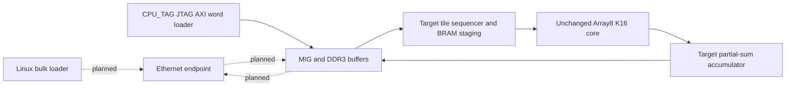

# PRX100 DDR3 and bulk data path investigation

Investigation dated2026-10-16. The recommended next target is **DDR3 plus
Gigabit Ethernet bulk transfers, BRAM staging, and a target-side tile
sequencer**. Standalone DDR calibration and complete256MiB testing through
CPU_TAG/JTAG-to-AXI now pass three configuration cycles. Median write ingress
is1354.957MB/s and read/verify1037.835MB/s. The
[physical qualification ledger](evidence/prx100-ddr-memory-20261016.md) defines
coverage and counter limitations. The later
[DDR-to-core target](evidence/prx100-ddr-projection-20261016.md) now connects
that qualified memory through BRAM staging, a target-side tile sequencer and
INT32 accumulator. All20 board jobs pass, including18 full Qwen blocks;
complete FPGA latency is median2.36871ms versus177us for the scalar CPU.
The current volatile image uses JTAG control and a word DDR portal. Ethernet
and a burst bulk path remain proposals.

The [cache/staging optimization](evidence/prx100-ddr-optimization-20261016.md)
now passes the same20 jobs with median1.76730ms,25.39% below the initial DDR
target. DDR wait is0.49702ms and unchanged core service1.22880ms. Sparse
descriptor updates save1512 cycles (30.24us); source word counters keep their
original meanings. The fresh scalar CPU takes183us, while per-word JTAG still
dominates host diagnostics. This optimization adds no Ethernet or bulk host path.

The subsequent [loading pipeline](evidence/prx100-core-loading-20261016.md)
passes20 jobs in median1.37524ms,22.18% below the cache image, by overlapping
inactive operand BRAM writes with current core reads/service and removing
partial-write advance states. Core service stays1.22880ms; target1.1 timing
counters now overlap. The fresh scalar reference is182us; resident JTAG
launch/observation remains15ms. Portable core, bridge, clocks and4.5 BRAM/11 DSP
counts remain unchanged. Bulk host transport and the byte-memory core service
cost remain limitations.

The [descriptor publication pipeline](evidence/prx100-publication-20261017.md)
then reuses consumer-released ring storage and publishes one tile ahead while
current retirement/collection proceeds. All20 jobs pass at1.12750ms median,
18.01% below1.1; unchanged core/bridge/clocks and4.5BRAM/11DSP remain bound by
exact identities. Target1.2 core work also occurs outside its core-wait window,
so0.99597ms core-wait is not a standalone core-service measurement. Fresh scalar
CPU is176us and resident JTAG observation16ms. Host upload/readback still takes
seconds; bulk transport and the core's byte-memory path remain performance work.

The [byte-memory port isolation](evidence/prx100-byte-20261017.md) now gives
target-side result collection an independent BRAM read port and reads the
next C word during the current partial write. Fresh baseline/new-image A/B
campaigns pass20 jobs each. Median FPGA time is1.12747→1.12710ms: only0.033%
lower, with one additional BRAM tile. The unchanged core already consumes
byte responses at its earliest supported edge; its serialized transaction
schedule still dominates. Scalar CPU184us is6.13 times faster for this block.

The subsequent [portable word-read core](evidence/prx100-word-20261017.md)
uses aligned four-byte descriptor/operand reads with byte fallback at row tails.
Fresh target1.3→1.4 A/B passes20 jobs per image; median FPGA latency falls
1.12710→0.53526ms,52.51% lower (2.11× faster). Core requests fall280→76 per
tile, verified by new hardware counters. Legacy core identities, arithmetic,
DDR bridge and clocks remain preserved. All1176 native tests and independent
core/controller RTL replays pass. DDR-wait activity is now0.49673ms median,
near total job time; overlapping counters do not define a disjoint partition.
Scalar CPU183µs remains2.93 times faster and bulk JTAG transfers remain slow.

The [DDR line-staging target](evidence/prx100-staging-20261017.md) then streams
each fetched line as four owned response beats directly into inactive BRAM.
The exact1.4 core and clocks remain unchanged. Fresh1.4→1.5 A/B passes20 jobs
per image with FPGA median0.53596→0.48102ms,10.25% lower (1.11× faster).
Staging activity falls0.40906→0.29776ms; DDR-wait activity falls
0.49743→0.38600ms. Core, staging and DDR windows overlap. Front-end read
requests fall36→9 per tile, while native line traffic and core requests remain
unchanged. Scalar CPU183µs remains2.63 times faster; the host workload is still
about97s. Serialized result writes, core loading and bulk host transfers remain
performance work; this is still one eight-output projection block.

The [investigation ledger](evidence/prx100-ddr-investigation-20261016.md)
records actual headless Vivado discovery and source protection. The existing
[UART contract](PRX100_BOARD_CONTRACT.md), Device ABI1.0, descriptor0.2,
Array8/K16 core and4096-byte aperture remain unchanged. No new image was
programmed during this investigation.

The later standalone target qualifies the800MT/s MIG configuration, disabled
CS, internal VREF, external50MHz system-clock topology and routed timing
described as candidates below. Historical discovery observations remain;
use the qualification ledger and frozen configs for actual builds.

## Board evidence

Sources are the supplied `PRX100_DDR原理图.pdf`, DDRV1.0 dated2021-07-05,
and `PRX100-D开发板硬件参考指南.pdf`, V1.2. Page numbers below are physical
PDF pages, not the schematic title-block sheet numbers. The supplied lab
manual still contains older SRAM examples; its SRAM wiring is unsuitable
for this DDR board.

| Item | Verified finding | Source |
| --- | --- | --- |
| FPGA | XC7A100T-2FGG676I; Vivado part `xc7a100tfgg676-2` | Guide; installed2025.2 device database |
| DDR3 | One MT41J128M16HA-125,128Megx16,256MiB,1.5V | Schematic PDF23/sheet24; guide PDF37–39 |
| DDR bank | All47 connected memory pins in HR bank13,1.5V | Schematic PDF7/sheet08; Vivado package-pin query |
| Oscillator |50MHz, D18, bank16, `IO_L12P_T1_MRCC_16`, IOB_X0Y176 | Schematic and Vivado package-pin query |
| Ethernet | RTL8211E-VB, RGMII,10/100/1000,25MHz PHY crystal,3.3V IO | Schematic PDF14/sheet15; guide PDF22 |
| Ethernet bank | All15 listed Ethernet signals in bank15; RX clock K21 is MRCC | Vivado package-pin query |
| CPU_TAG | FT2232HL channelA routes to FPGA JTAG; channelB serves CPU debug | Schematic PDF20 and FPGA JTAG selector |

The schematic supports these findings; actual PCB population, bank voltages,
strap readback and signal integrity remain physical acceptance conditions.

## DDR3 configuration candidate

Use MIG7Series4.2, a single16-bit component and one rank,14 row bits,10 column
bits and3 bank bits. The installed memory catalog explicitly maps
`MT41J128M16XX-125` to `MT41J128M16HA-125` at1.5V. Do not substitute a1.35V
DDR3L preset from another board.

Start configuration validation at800MT/s:400MHz memory CK,4:1 PHY ratio,
nominal100MHz UI and128-bit native data beats. This gives a **raw theoretical
1.6GB/s**, before refresh, commands, turnaround, arbitration and staging.
It is not a measured rate. The -2 device's MIG DDR3 limit is800Mb/s per pin
for4:1 and700Mb/s for2:1; internal VREF also limits operation to800Mb/s.
See [DS181 table16](https://docs.amd.com/api/khub/documents/iAkxxTOk96ANLJqYf2hgrQ/content)
and [UG586 VREF](https://docs.amd.com/r/en-US/ug586_7Series_MIS/VREF).

Three board details need explicit treatment:

- **CS# is tied low.** The DRAM `PL_DDR_CS_N` net has R2224.7k to ground,
  with no FPGA pad. Disable the controller chip-select output. The installed
  MIG component metadata supports `DDR3_USE_CS_PORT=0`; generating and
  validating that exact board configuration remains open. Do not invent a
  package pin or leave an unconstrained CS output.
- **Internal VREF is required by this pin assignment.** W18 is bank13's
  VREF-capable pad and carries BA1. The other VREF-capable pad W24 is shown
  unconnected. Select internal0.75V VREF for bank13 and retain MIG-generated
  constraints. The DRAM's separate VTTVREF_PL and VTT termination supplies
  do not make an FPGA VREF input connection.
- **Keep the external system-clock source.** Feed the50MHz oscillator
  directly, through the qualified input/buffering topology, to MIG's system
  clock. A separate MMCM may generate the200MHz IDELAY reference. Do not
  cascade a50→200MHz clock wizard into MIG's system clock: [UG586 DDR3 input
  clock rules](https://docs.amd.com/r/en-US/ug586_7Series_MIS/Input-Clock-Guidelines?contentId=S~2xf7GROEYKuLCPG~tYJg)
  prohibit an internally generated system clock. `NO_BUFFER` can omit a
  duplicate input buffer; it does not waive that rule.

D18 and the DDR pins are in the same IO column, with DDR clock CK on bank13.
MIG's PLL must be placed with the memory clock bank and may need a supported
CMT backbone route from bank16. The800MT/s candidate would need a PLL
multiplier16 from50MHz to800MHz VCO, then divide2 for400MHz CK; this is
arithmetic, not an accepted MIG/placed configuration. Confirm the generator's
allowed input periods, PLL limits, jitter and placement. Retain any specific
MIG-produced BACKBONE constraint; do not suppress failures with an arbitrary
`CLOCK_DEDICATED_ROUTE FALSE`. If this topology fails, resolve the clock
source/rate legally before hardware testing. See [UG586 placement
rules](https://docs.amd.com/r/en-US/ug586_7Series_MIS/System-Clock-PLL-and-MMCM-Locations-and-Constraints).

The discovery probe successfully configures Clocking Wizard6.0 with50MHz
input,200MHz and125MHz outputs: MMCM multiply20, divide1, output divides5
and8. This confirms parameter acceptance only; no generated-clock timing,
MIG connection or routed design was tested.

### DDR package pins

Indices in a row are ascending. These are wiring facts, **not a qualified
MIG project or standalone XDC**. MIG must check byte groups, strobes, IO
standards, VREF and clock resources together.

| Signal | Package pin(s) |
| --- | --- |
| DQ[0..7] | Y25,V24,AA25,U25,Y26,V26,W25,W26 |
| DQ[8..15] | Y23,AA22,W23,AA23,V23,AB25,U22,AA24 |
| DQS_P[0..1] | AB26,AB24 |
| DQS_N[0..1] | AC26,AC24 |
| DM[0..1] | U26,Y22 |
| A[0..6] | W20,V18,U14,T18,V17,T17,V14 |
| A[7..13] | U16,T14,U15,W21,V16,W19,T15 |
| BA[0..2] | T19,W18,Y20 |
| CK_P / CK_N | U21 / V21 |
| CKE / ODT | Y21 / T20 |
| RAS_N / CAS_N / WE_N | U20 / U19 / V19 |
| RESET_N | U24 |
| CS_N | No FPGA pad; R222 pulldown |

DQ[0..7] and DQS0 occupy bank13 T0; DQ[8..15] and DQS1 occupy T1.
Address/control occupy T2/T3 plus RESET_N at IO_0. A14/A15 are not required
for the populated2Gb x16 geometry and must not receive invented pins.
Use the generator's SSTL15/differential SSTL15 and reset IO decisions, never
the UART shell's blanket LVCMOS33 settings for these memory signals.

## Faster host interface

| Path | Assessment |
| --- | --- |
| Gigabit Ethernet/RGMII | Selected bulk path. Existing PHY/RJ45; raw125MB/s line ceiling. MAC, packet transport, CDC and buffers still needed. |
| CPU_TAG JTAG-to-AXI | Qualified interim word diagnostic path. The checked32-bit RPC client measures650 useful bytes/s write and558 read; a fast burst loader remains separate. |
| Faster/batched UART | Small fallback improvement. Changing baud alone preserves framing overhead; classic CP2102 is not CP2102N. |
| FT2232 USB FIFO | Existing CPU_TAG wiring supplies JTAG/CPU debug, not an8-bit FIFO bus to FPGA. |
| SD card | Possible local model storage later; does not provide the requested fast host path. |
| Expansion connector | Do not treat camera/expansion labeling as a working PC PCIe endpoint. |

The installed IP-status report marks MIG4.2, Clocking Wizard6.0 and
JTAG-to-AXI1.2 **Included**, but Tri-Mode Ethernet MAC9.0 **Design_Linking**.
No hardware-capable TEMAC license was established. Select a usable license
or a separately reviewed/validated MAC implementation before producing the
Ethernet target. Catalog presence and `create_ip` success are insufficient;
see [AMD IP licensing](https://docs.amd.com/r/2025.2-English/ug896-vivado-ip/Using-Fee-Based-Licensed-IP).

### Ethernet package pins and timing

| Signal | Package pin(s) |
| --- | --- |
| RXD[0..3] | L14,K15,J14,J15 |
| RX_CTL / RX_CLK | M14 / K21 |
| TXD[0..3] | K16,K17,K18,H19 |
| TX_CTL / TX_CLK | G20 / J16 |
| MDC / MDIO / INT_N | F22 / J20 / J19 |

The schematic strap table selects PHY address001 and internal TX/RX delay
through RXD1 and LED2 pullups. Read PHY identity, address, delay registers
and negotiated speed through MDIO; actual straps need confirmation before
choosing RGMII capture and transmit phase. Avoid adding a second skew delay.
The PHY reset is an RC/pullup net; no FPGA reset output is assigned here.
Bank15 is3.3V HR IO. Use explicit input/output delay constraints on both DDR
edges, appropriate IDDR/ODDR/IDELAY and clock resources, and PHY/PCB timing
budgets. See [AMD RGMII IO/placement guidance](https://docs.amd.com/r/en-US/pg051-tri-mode-eth-mac/I/O-Standard-and-Placement).

## Integration contract around the unchanged core

DDR stores packed tensor/layer data. The implemented target uses a serialized
word bridge and sequencer; a burst mover is the next data-path optimization.
They assemble descriptors and tiles in the existing4KiB BRAM aperture, publish
work, drain ordered completions and collect partial sums. This avoids a host
round trip for each tile/word. Merely placing DDR behind the current
single-outstanding, byte-oriented core memory interface leaves another major
bottleneck. Do not enlarge K, widen the portable memory bus or change ABI
semantics as an incidental part of this target work.

Use one owner for the staging aperture at a time. Preserve the current
quiescent rule before descriptor/operand replacement: producer equals retired,
with no held completion. Bulk transfers can fill separate owned DDR buffers
while the core runs, but must not overwrite an active staging allocation.
The sequencer must honor ready/valid acceptance and all four completions;
counter snapshots retain their existing meaning. Long-K sums need checked
width bounds; this Qwen K1024 INT8 case fits signed32-bit, but an unbounded
workload must not silently wrap. Scaling/RMSNorm remain outside the core.

Use explicit asynchronous FIFOs/ownership crossings between the Ethernet
125MHz domain, MIG UI domain and50MHz core domain. Reset must invalidate
pending traffic/session ownership, synchronize release per domain and gate
DDR access until calibration completes. Reset does not clear DDR contents.
A two-flop synchronizer is suitable for a status bit, not a wide data bus.

Define a separately versioned bounded bulk protocol, initially UDP/IPv4 on an
isolated link, with explicit byte addresses, lengths, session IDs, transaction
IDs, offsets and payload checksums. Stage and verify a chunk before exposing
it, acknowledge writes only after commit, bound outstanding work and define
duplicate/out-of-order/retry handling. Lost acknowledgments must not execute
jobs twice. Stale sessions and incomplete uploads must not publish work.
Constrain packet sizes to avoid IP fragmentation. CRC/FCS and an application
checksum serve different checks. Do not silently reinterpret UART version1
commands as this protocol.

Prefer AXI byte addresses for the initial DDR diagnostic bridge;256MiB needs
28 address bits. If using MIG's native interface, derive its command-address
units, ordering and beat widths from the exact generated configuration rather
than assuming `app_addr` is a byte pointer. JTAG-to-AXI can share the control
plane through explicit arbitration, never concurrent unowned writes.

First-party controller, sequencer, diagnostics and host automation remain
MoonBit. MIG/clock/physical IO wrappers stay target-specific vendor boundaries;
canonical IR, emitter and simulator semantics do not change. Model execution
and token/KV management belong to an external runtime adapter.

The board remains beside the Linux server. Later Ethernet testing needs an
RJ45 cable to a suitable server interface/switch. The Ubuntu guest currently
uses QEMU NAT: a board's Ethernet traffic will not automatically appear inside
that guest. A Linux-host UDP client on an existing isolated route is the first
candidate; document routing before considering a guest bridge or passthrough.
No host network, firewall, OS or VM configuration was changed here.
Read-only host PCI discovery finds Intel I219-LM and I210 Gigabit controllers
and another Intel Ethernet controller. This does not identify a free physical
port or a board link. Existing active/bridged interfaces must not be repurposed
without an explicit wiring/routing plan that preserves server access.

## Quantified limits and Qwen scope

The [real W8A8 projection](evidence/prx100-qwen-projection-20261016.md)
takes74.914–77.739s per input in the verification harness, with31.670–31.764s
of UART round trips. Its6272 steady-state exchanges carry301056 framed wire
bytes, a26.133s floor at115200baud8N1. Pure Write32 traffic has only960 useful
bytes/s before software gaps. These measurements do not establish FPGA
acceleration over the182us scalar CPU reference.

An autonomous eight-channel K1024 projection would need8192 weight-code bytes
once,1024 activation-code bytes per input, and32 final result bytes. That is
9248 bytes for the first input and1056 for later inputs with resident weights,
excluding scales, job descriptors, packet headers/ACKs and internal traffic.
The sequencer and accumulator are now implemented and physically checked for
this eight-channel block. Resident job counters exclude host upload and
verification. Measured core loading/control and serialized DDR waits still
dominate; the30.72us compute counter is about1.3% of complete job time.

Gigabit Ethernet has a raw125MB/s ceiling. With standard MTU1500, IPv4/UDP and
a32-byte bulk header,1440 useful bytes per1538 line bytes give an ideal
117.04MB/s ceiling, excluding ACKs, losses and software gaps. A50MB/s bulk
acceptance goal would upload256MiB in5.37s. These are calculations/goals,
not measured Ethernet or DDR performance. `scripts/prx100-data-path-budget.mbtx`
reproduces the numbers without accessing hardware.

| Qwen3-0.6B weight representation | Ideal storage | Fits256MiB? |
| --- | ---: | --- |
| INT8 |568.4375MiB| No |
| Packed4-bit |284.21875MiB| No, before scales/KV/workspace |
| Packed3-bit |213.16406MiB| Weights only;42.83594MiB left before overhead |

The parameter count stores the configured tied embedding/output matrix once.
The retained checkpoint header actually serializes both `lm_head.weight` and
`model.embed_tokens.weight` (751632384 stored elements including that
duplication). These ideal capacity estimates assume a runtime/packer honors
`tie_word_embeddings=true` and stores one shared matrix; they are not the
checkpoint file size. Full byte equality of the two serialized matrices was
not checked by the earlier range download.

Packing all weights to3 bits
has no demonstrated model-quality result, and the current core consumes
INT8, so it would also need a target unpack/dequantization strategy. A DDR
cache with host-assisted layer streaming is the practical next Qwen milestone.
Faster transport does not supply attention, nonlinear operators, KV management
or full-model numerical validation. No tokens/s prediction is justified.

## Ordered acceptance work

1. **MIG configuration and standalone memory test.** Generate and freeze the
   exact PRX100 `.prj`/XCI with the pin table, disabled CS, internal VREF and
   legal external50MHz clock topology. Pass generated output, pin/clock DRC,
   routed setup/hold timing and calibration on hardware. Expose calibration
   stages/errors via UART. Run full256MiB address/bank tests, walking bits,
   checkerboards, byte masks, burst/random traffic, refresh/idle and repeated
   reset tests. Measure independent read/write bandwidth and combined traffic.
   The standalone full-address/pattern/mask/idle/reload subset is now complete;
   see the physical ledger. Random mixed traffic, exhaustive walking/March
   tests and extended environmental/soak qualification remain additional work.
2. **JTAG-to-AXI diagnostic bridge.** First test known BRAM, then qualified
   DDR; verify burst readback/byte order/bounds and time actual transfers.
   Use existing CPU_TAG, without changing portable accelerator ports.
   JTAG-to-AXI control/status of the autonomous DDR tester is qualified. This
   has since been extended with the checked word DDR aperture and actual
   upload/readback measurements above. Fast burst loading remains additional work.
3. **Ethernet with BRAM buffers.** Resolve MAC implementation/license. Verify
   MDIO identity/straps,1Gb full-duplex link, CRC/error counters and explicit
   RGMII timing. Test packet echo, bulk writes/readback, boundary sizes, loss,
   duplicates, reset and stale sessions. Establish sustained throughput first
   at10MB/s, then pursue50MB/s on sufficiently large buffers; both are goals.
4. **Ethernet to DDR.** Add bounded burst buffering/arbitration and exercise
   backpressure, partial transfers, ownership and concurrent read/write load.
   Retain independent hashes and throughput phase timings.
5. **Autonomous tiled Qwen block.** Reuse the exact pinned W8A8 fixture,
   require all1536 partials and24 final sums to match independent CPU results,
   then repeat numerical/error and timing comparisons with resident weights.
   Retain integer sums as well as dequantized outputs. The first eight-channel
   target now passes this numerical/repetition gate with all1536 partials,
   target-side sums and15 resident repeats. Extend to larger real
   projections/layers before attempting a short-context host inference loop.

Each new digital component needs its scoped LunaWave/differential/formal gates
before a physical claim. Archive unique inputs, generated RTL/XDC/configs,
tool identities, failed attempts, timing/DRC reports and raw measurements.
Keep caches outside sealed evidence and preserve the previously qualified
Array8 image as the recovery configuration.

## DDR result-write continuation — target1.6

The [batched DDR result writes](evidence/prx100-results-20261017.md) pass a fresh20-job campaign per image: **0.48054→0.45618ms median**, **5.07% lower** (1.053×). All40 jobs match the signed CPU reference; writes fall520→130 per full block, with the same portable core and clocks. The scalar CPU is183µs; the new FPGA remains2.49 times slower. Host/JTAG transfers remain dominant; full-model inference remains separate work.

## DDR streaming continuation — target1.7

The [DDR streaming and descriptor staging continuation](evidence/prx100-stream-20261017.md) passes40 fresh A/B jobs: **0.45630→0.41775ms median**, **8.45% lower** (1.092×), with the exact portable core and clocks. Front-end reads fall576→128/full block; native traffic is unchanged. Scalar CPU183µs remains faster; host/JTAG and full-model integration remain open.
